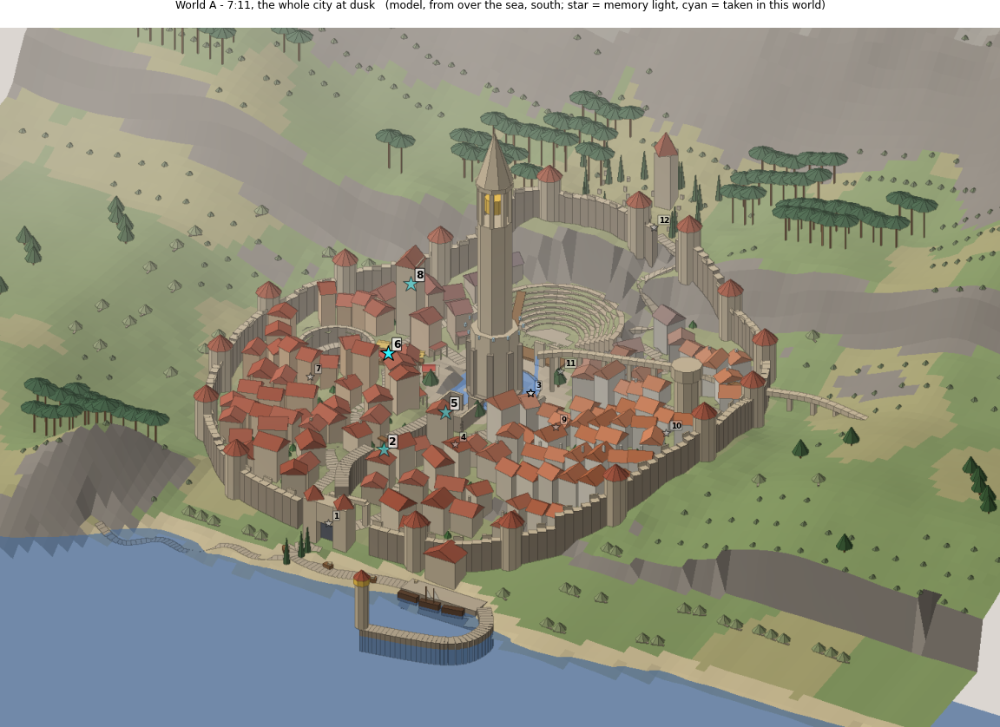
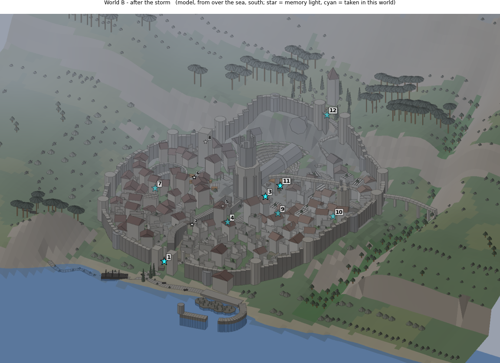
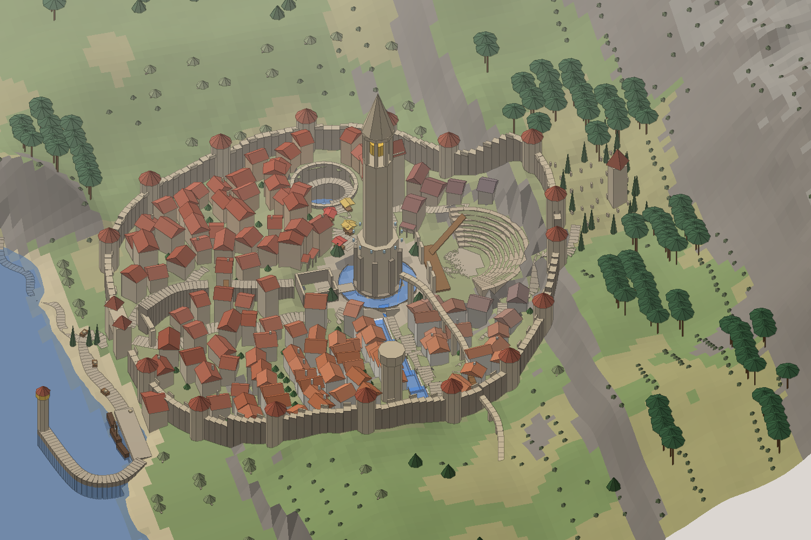
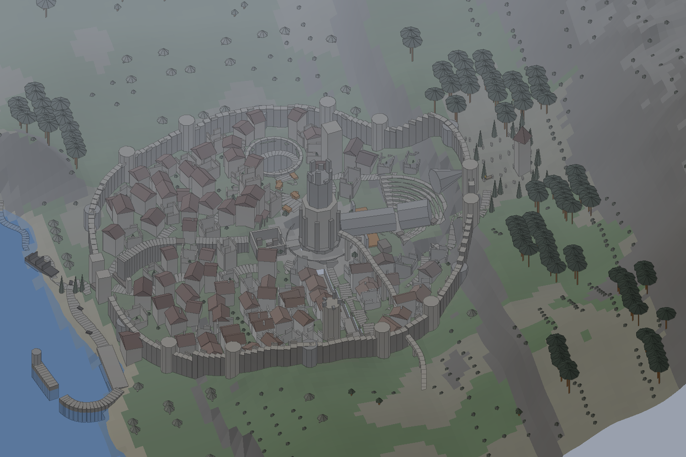
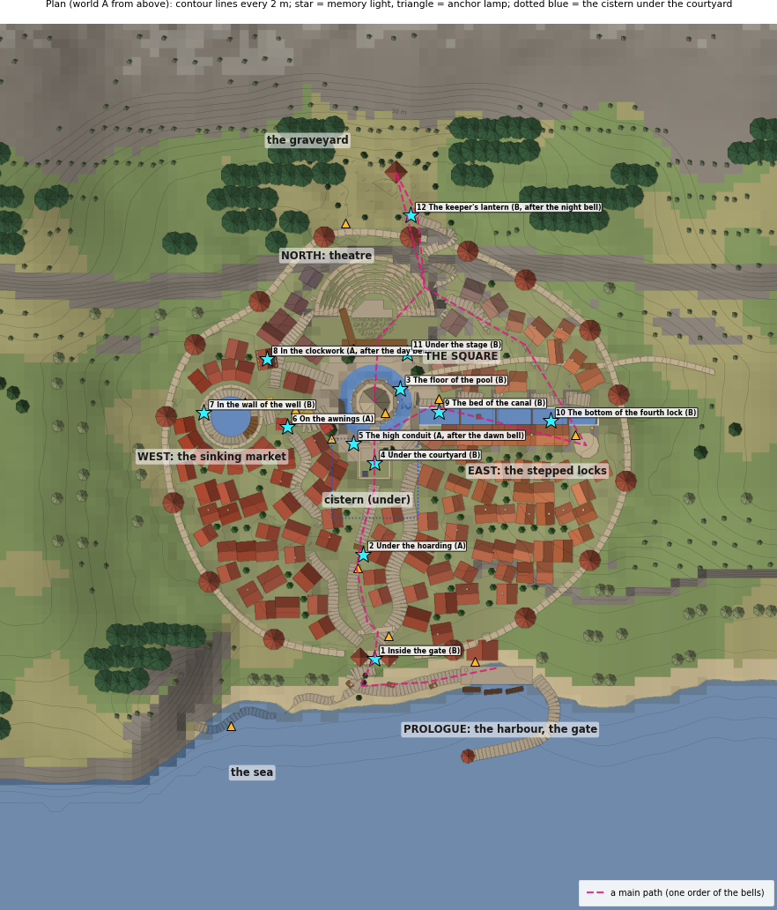
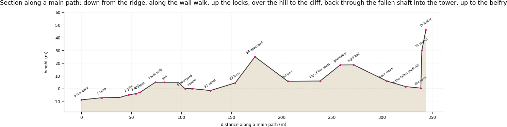

# Level Design

The design of the map: the story that gives it a reason, the city in three dimensions, what each part teaches, how it is
proved, and in which order it is built. The code points here by section number; section 14 keeps the rules of the current
build under the numbers the code uses.

## 0. Summary

A walled harbour town on a hillside between the mountain and the sea, in two moments: world A, the town whole and empty in a
held evening; world B, the same town much later, in ruins. The body carries a lantern that moves it between the two: that is
the layer switch, still the only rule. What happened between the two moments is the story, and it is decided last
(section 1): nothing of the map, the puzzles or the code depends on it.

Three districts round a sunken square each hold one of three goals, called bells until the story names them. Two of them
open the tower in the middle of the square; the third opens a hidden floor of it. Every bell changes the city for good, in
both worlds, so a district already played opens new ways. At the top of the tower the last goal is reached, and the world
the body stands in at that moment becomes the end.

| Item | Current build | This design |
|---|---|---|
| Shape | a hub, three wings, a cathedral, on the ground of a town by the sea | one city on one terrain: curved streets, districts that run into one another, four heights; every district entered two ways |
| Goal | three seals (each rings a bell: 1.2) | any two of three bells; the third is optional and changes the end |
| Reward of exploring | hidden lights; two of them bring back a memory fragment | memory lights: each one brings back a piece of A inside B, as a shortcut or a view |
| Return | shortcuts | shortcuts, travel between lit lamps, and a city that changes with every bell |
| End | a goal light, then an end screen | three endings, chosen with the one rule |
| Guidance | outlines, columns of light, prompts | the same, the scene itself (section 9), and a guide figure whose story is open |

## 1. Story and the main line

### 1.1 Open

The story is decided last. Three drafts were discussed on 2026-11-23 and dropped, each because it needed a rule that did not
hold (a storm held by a bell that could not be finished alone; an escape by ship that the bells could not guide; warnings rung
in relay in a town small enough for one bell). What the map needs from any story is small, and it is fixed here:

| Need | Fixed as |
|---|---|
| Two moments of one town | A: whole and empty, at a held evening; B: the same town later, in ruins. Things made by people are whole in A; what fell is in B (14.3) |
| A reason to cross the city | three goals in three districts (the bells), any two open the tower, the third opens a hidden floor of it |
| The switch | a lantern carried by the body; its flame and its glass tell which moment it shows (1.4) |
| The end | chosen by the world the body stands in at the last moment (1.5) |
| Placeholders | the times (7:11, 7:12), the keeper and his room in sections 4, 6 and 8 come from the drafts and are renamed with the story |
| Telling | without words, by the places and pairs of things in A and B (section 9) |

When the story is written, sections 1.2 to 1.5 and the examples of 9.2 are filled in with it; the rules stay.

### 1.2 The bells

The three districts can be played in any order. A bell is reached where it can be: where it still hangs, or where it has
fallen. Two rung bells open the door of the tower; the third opens a hidden floor inside it (T4). Ringing a bell does two
things:

- The echo: for a few seconds pale figures walk out of the houses of that district (what they show is the story). They show
  the streets of the district once more.
- The change: the city changes for good, in both worlds, and a district already played opens new ways.

| Bell | District | Where it is rung | What changes, for good | What it opens |
|---|---|---|---|---|
| Dawn bell | east, the stepped locks | under the tank of the water tower, in A (in B the top of the tower has fallen in) | the master sluice of the aqueduct opens: every water of A rises one step | the crate on the cistern water reaches the high conduit; low ways of A go under water, other ways round |
| Day bell | west, the sinking market | at the bottom of the great well, in B (it fell through the floors); in A it hangs in the clock tower, out of reach | the machinery of the city turns again (A only) | the bucket lift of the well (a shortcut up), the gear lift of the clock tower, the lock gates of the east turn on their own |
| Night bell | north, the graveyard | on the night bell tower, in either world | night falls in A; the street lamps of A are lit | lit lamps show marks on the walls (section 9); a lantern on a grave burns |

What a bell opens is never needed for the main path, so any order of the bells finishes the game. Section 11 proves this for
every set of rung bells.

In the current build the seals of the wings ring the bells (`scene/CityState.h`): the east seal is the dawn bell, the west seal
the day bell, the north seal the night bell. What each one does there:

| Bell | In the current build |
|---|---|
| Dawn | every water of A (the trench, the pool, the cellar) rises 0.3 m over 3 s; no place of return goes under water (TestRecovery) |
| Day | the lock of the canal opens by itself, also after R; the weir does not (it would move the crate off the main path) |
| Night | the theme of A eases to a night theme over 6 s (a low moon, a dark sky); the street lamps and the marks come with step 12 |

### 1.3 The lantern

The lantern is the switch (1.4) and has two abilities, both practical, neither a new rule:

| When | Ability | What it does | Why |
|---|---|---|---|
| after the first bell | lamp travel | at any lit anchor lamp, E opens the list of the lit lamps, each with its name and a small view of its place; left and right choose, E travels, Esc closes. The body arrives standing beside the chosen lamp, in the layer it left, with the ring of a respawn. A lamp whose place is not free in that layer is shown but cannot be chosen | the city is large and wound; going back is the reward of exploring, so going back must be quick and the player decides where to |
| after the second bell | resonance | the lantern at the bottom of the screen pulses while a memory light not yet taken is within 25 m, faster as it comes nearer; when that light is out of view, a faint mark at the edge of the screen shows its side | the lights are hidden on purpose; this says "here is one" without saying where |

### 1.4 The switch

The rule stays: one key moves the body between the two moments. What changes is how it feels and how much it tells.

| Change | How | State |
|---|---|---|
| Refused into water | a switch is refused into the water of the other world as into a wall (`scene/Recovery.h`): the body would only come up again at the entry of its room | built |
| Look before going | a tap of Tab switches at once (the switch in the air needs it). Holding Tab opens a sphere round the lantern in which the other world is drawn, growing to 6 m in 0.4 s; outside it nothing changes and time runs on. Releasing switches; right mouse or Q closes it without switching. Built on the ripple (`render/LayerRipple.h`) | planned |
| A switch that waits | a switch refused because the body would be inside something is kept for 0.15 s and happens as soon as the body fits | planned |
| Refused, and why | the blocker flashes in both layers (built for pushes); the lantern gutters | partly built |
| The lantern says which moment | its flame is warm in A and cold in B | planned |
| What never changes | the anchor lamps, the foot of the tower, the lantern itself, the shape of the hills | built (lamps, the ground) |
| Sound | each moment has its own sound; a switch cross-fades them in the time of the ripple | planned, with the music |

### 1.5 The endings

At the last moment the city flickers between its two moments; the world the body stands in at the end stays. Three endings,
written with the story:

| Ending | Chosen by | Shape |
|---|---|---|
| The past | standing in A | the held moment is kept: the town whole and empty for good |
| The present | standing in B | time moves on in B: rain, green over the ruins, people coming back |
| Both | after the hidden floor of the tower (three bells), holding Tab through the last moment (both worlds at once) | as the present, and every piece of A that the memory lights brought back stays standing among the ruins |

The memory lights are not a condition: they decide how much of A stands in the third ending. After an ending the body is back
before the last moment, so the other endings are seen without playing again.

## 2. Goals and hard limits

| Goal | How it is judged |
|---|---|
| One rule | the body has one ability, the layer switch; objects react to it; the lantern only travels between lit lamps and points at lights |
| Hard in the head, not the hands | every main-path jump within the limits of section 10; precise jumps only for optional lights |
| One "of course!" per room | each room names its moment in one sentence; a room without one is cut |
| Teach, then turn round | the first room of an object has no dead end; later rooms use it the other way |
| One city, not parts | districts meet in seams (5.2), never at a line or a door; the same houses, streets and stone run through all of them; a district is told by its height, its landmark and its trade, not by a border |
| A world, not boxes | the city stands on a terrain; no view shows the void (the mountain, the sea, the hills, the ground under every floor); nothing floats (every platform stands on a pier, a beam, scaffolding or rock); walls in three parts (plinth, wall, cornice), broken edges in B |
| Never a long straight way | no street, lane or corridor runs straight for more than 15 m; streets follow the slope |
| The wish to explore | the tower is seen from everywhere; each district has a landmark; a view of the next goal from every high point; 12 memory lights that change the map |
| The wish to finish | the bells; the tower changes as they ring; the ring of twelve lamps round the tower shows the lights taken |
| Proved | push puzzles by the solver; every room walked by the real body; skips searched; every set of rung bells searched |

## 3. References

| Work | Borrowed | Where |
|---|---|---|
| Elden Ring (Stormveil, Leyndell) | two great runes before the capital; layered space; seen before reached; one-way shortcuts; a landmark on the horizon | two of three bells open the tower; districts seen from the wall walk; the fallen tower seen long before it is walked |
| Dark Souls | shortcuts back to a known rest point as the reward of exploring | anchor lamps, lamp travel |
| Zelda: Breath of the Wild | one mechanic per room, safe first, then combined | every object taught in a room without a dead end |
| Super Mario Odyssey | many uses of one mechanic; collectibles that appear after others | memory lights; three lights that appear only after a bell |
| Portal | one thing at a time, then turned round | the last room of each district turns its object round |
| Outer Wilds | a world that tells its story by its places; the ending decided by where the player stands | the clocks, the grave, the ghost; the last stroke |
| Hill towns of Italy and the Adriatic | streets that follow the contour, stairs where they cannot, a square at the meeting of the streets | the street plan of section 5 |

## 4. Objects

Each object answers one question: what happens to it when the body switches layers?

| Object | Rule | Taught | Turned round |
|---|---|---|---|
| Layer wall / floor | exists in one layer (A: wood and iron; B: fallen masonry) | prologue, the gate | north: the prism moves it to the other layer |
| Crate, pushed | in both layers, so it obeys the walls of both; pushed along flagstones, one flagstone at a time | the courtyard | E2b: pushed in B, lifted in A |
| Plate and door | plate in one layer, door in the other; the door is open while the plate is pressed | the courtyard | west: the orb holds the plate while the body is in the other layer |
| Orb | carried, it switches with the body; put down, it stays in its layer and falls to the first surface of that layer; it works sockets and plates | W1 | W3: dropped down the well, it arrives at the bottom |
| Water (A) | not a floor for the body; things float on it; fed by the aqueduct (14.4) | the square, E1 | E3: the locks lift the crate step by step; the dawn bell raises all of it |
| Crate, floating | the same crate: in both layers; floats on the water of A, lies on the bed in B, moved in both at once | E1 | E2: moved in A, used in B |
| Wheel | machinery: turns only for a body in A | E1 | the day bell: machinery that turns on its own |
| Prism | stepped on in either layer, it moves the things linked to it into the other layer, for good | N1 | N2: one prism, two things; N3: scenery of A becomes a stair of B |
| Clock hands | the hands of the tower clock are bridges; A shows 7:11, B 7:12, the hour hand of B has broken off and fallen across the pit | T1 | - |
| Memory fragment | a piece of A that appears in B, in pale glowing stone, when its memory light is taken; solid in B | section 8 | the third ending |
| One-way door, grate, bars | open from one side only, and stay open | W4, the undercroft | the cistern grate, opened from the far side |

Not used on purpose: free physics, throwing, timers in the main path. They would move the difficulty back to the hands.

## 5. The city

### 5.1 The model

The map is planned on a model, `tools/layout/city_model.py` (Python 3, numpy and matplotlib). The city stands on a terrain,
a height field shaped by noise (5.4): the sea to the south with its harbour cove, a headland to the south-west, a hillside
that rises to the east, the cliff and the mountain to the north. The harbour, the plants and the things the town left
behind are placed by the rules of 5.5 and 5.6. Streets are curves; each cuts its own bed into the slope (at most 24 degrees, stairs 31, cut and fill
where the ground is steeper). The houses are placed in the order a town grows: first the fronts of the places (a ring of
tall houses round the square, arcaded on its market side; a ring round the well; houses beside the theatre; a row on the
south bank of the locks whose back walls are the wall of the canal), then row houses along every street, sharing their side
walls, with a second row behind, then the blocks between, each house turned to its nearest street, then gardens. The
landmarks stand on the same terrain. The script draws the pictures below into `docs/images` and checks the
grades of the streets, the longest straight run of each street, the memory lights and the anchor lamps:

    python tools/layout/city_model.py            (all pictures; about fifteen minutes)
    python tools/layout/city_model.py plan       (one picture: a, b, aerial, plan, section; none checks only)

In the model y = 0 is the rim of the square; the game uses y = -1 for it.

| Part | Where, height | Theme and object | Bell | Shape |
|---|---|---|---|---|
| Prologue | the ridge road from the guardhouse (+8) down two hairpins to the gate (-1), the barbican, the wall walk (+5), the courtyard (0) | the switch, the switch in the air, the crate | - | a road that winds down the ridge; a gate between two towers; a wall walk with a break |
| Square | the middle; a round place 32 m across, rim 0, pool -1.5; the tower to +67 (A) or +31 (B) | the two faces of the city | the great bell | where the streets meet; the fallen bell in the pool |
| West, the sinking market | west; the market street (0) to the great well (-15.5) | the orb | day | a market street that ends at the parapet of a well 16 m across; a spiral down its wall |
| East, the stepped locks | east; the lock walk climbs beside five basins from -1.5 to +11; the water tower to +30 | water, the crate, wheels | dawn | a canal that steps up the hillside; the aqueduct over the roofs |
| North, the theatre and the graveyard | north; the orchestra (+0.8), seats cut into the hillside to +10, the cliff path, the graveyard (+19 .. +22) | the prism | night | a theatre bowl in the slope, stairs up the cliff, a graveyard outside the wall |
| Links | between districts | - | - | the cistern under the courtyard (B); the walk of A along the aqueduct; the fall of the theatre into the well (B); the hollow shaft of the fallen tower (B) |

Every district is entered two ways: from the square and by a link. Every link is in one world only, so the second way in is
always a use of the rule.

### 5.2 Seams: where districts meet

A district does not end; it turns into the next. Each seam is a place of its own with something of both sides.

| Seam | Between | What makes it one place |
|---|---|---|
| The arcade of the market | square and west | the market street opens into the square under an arcade; its stalls stand on the rim of the square, its awnings are seen from the causeway |
| The fountain stair | square and east | the canal pours into the pool down a stepped channel beside a stair; the water of the east is the water of the square |
| The seats | square and north | the lowest seats of the theatre come down to the north rim; the square is the forecourt of the stage |
| The lower lane | prologue and west | the lane under the wall walk winds north between houses and arrives in the market from below |
| The high street | prologue and east | the street from the gate climbs along the east side of the courtyard into the square, past the first houses of the locks |
| The theatre lane | west and north | from the clock tower round the upper seats to the stage door; in B the seats here have fallen into the well |
| The hill lane | east and north | from the water tower over the hillside, under the aqueduct, to the top of the seats |
| The cliff path | north and the graveyard | stairs that turn three times up the cliff, outside the wall |

### 5.3 One town, four kinds of house

The districts are not islands round the landmarks: the same town runs through all of them, and its houses change slowly.

| Kind | Where it is strongest | Walls, roofs | Its own detail |
|---|---|---|---|
| Market house | west | ochre plaster, deep red tiles | an arcade on the street: shops under a portico; in B its pillars stand in a row with gaps |
| Lock house | east | whitewash, light tiles | built on the quay: its back wall is the wall of the canal |
| Hill house | north | grey stone, slate | small, on the hillside beside the theatre |
| Gate house | south | sandstone, red tiles | the plainest; the first houses the player walks past |

The colour of a house is a blend of the four by its distance to the middle of each district (a gaussian of 22 m), so a
street that runs from the market to the locks passes from ochre to white without a border. The square takes a little of each
side: arcaded toward the market, white toward the locks, grey toward the theatre.

In B one house in three is a ruin: no roof, its four walls broken to different heights, rubble and a young tree inside.
Arcades lose every other pillar. The rest keep their roofs, darker and grey. The town in B is the same town, not another.

### 5.4 The ground, the sea and the edges

The ground is shaped as land is shaped, not drawn as slopes. In the game it is a height field (`scene/Terrain.h`,
`scene/Landscape.h`): 2 m cells round the map and 8 m cells out to 300 m past every room, flat-shaded and baked into the static
batch. The fine field is pinned to the coarse one along its edge, so the two meet without a crack.

| Part | In the game |
|---|---|
| The town | levelled at the street, 5 cm under the floors of the map (`kPlainY`): the houses stand on it |
| The land | outside the town, noise: hills to the east and the west, a hillside under the mountain, the mountain to the north in ridged layers up to about 70 m, rough ground, rock where it is steep |
| The coast | a bay in front of the town, the shore coming north on either side; the bank falls from the town to the sea at -9, the sea floor further down |
| Pits | where the map has no floor at street level (the open sides of the prologue, the trench, the gap under the sky bridge, the pool, the lower west, the cellar and the canal, and four closed spaces between districts) the ground drops to -16, below every fall line (`kPits`). A fall stays a fall; nothing of the ground shows inside a room. The sea fills the pits: from the terrace the ravine of the prologue is a moat |
| Footings | a wall at street level or a deck at the edge of a pit gets a footing of rock down to the floor of the pit, drawn only, so that nothing floats; never through another box or a room below |
| Collision | the ground is solid for the walking body in both worlds; tests prove that no body reaches it from the map (test_terrain, "no escape") |

| Edge | What is seen | Why it is never the void |
|---|---|---|
| South | the bay, the open sea | the sea is one plane round the eye, wider than the far plane, its colour the colour of its world |
| West, east | hills, the coast turning north | the land reaches 300 m past every room |
| North | the hillside, the mountain in layers | the land reaches 300 m past every room and rises |
| Down | the floors of the pits, under the sea | the pits have floors; the sea covers them |

The sea without an edge: one flat plane at -9 that follows the eye (in steps of 20 m, so its surface does not slide), 720 m
across. The fog of each world is the colour of its sky, so the sea fades into it with no line where it ends. Still planned: a
sky dome with a gradient and a thicker fog over the sea; islands, the storm wall and ships as silhouettes in the fog (with the
story).

### 5.5 Where buildings stand, and why

A building in the wrong place is wrong in a way the player feels before they can say why. The game places the houses of the
town (`Stage::SkylinePlots`) by these rules; the model follows the same ones for the planned city.

| Thing | Stands where | Never where | In the game |
|---|---|---|---|
| Houses of the town | on plots along streets round the cathedral, each turned to its street (its walls face the cathedral or run round it, within a few degrees), sized so that it stays on its plot | within 4.5 m of a room (a jump never lands in a house it would fall through), over a pit, under the aqueduct | built |
| Colour | by quarter: ochre plaster and deep red tiles in the west, whitewash and light tiles in the east, grey stone and slate in the north, sandstone and red tiles in the south, blended by distance (no quarter has a border) | | built |
| Towers | now and then a tower over the roofs | | built |
| Gardens | one plot in eight is not built: a garden with lemon trees and a cypress | | built |
| B | one house in four is a shell: its walls broken lower, no roof; a quarter of the merlons and a third of the cornices have fallen | | built |
| Big houses, arcades | on the square and the main streets, where land is flat and people pass | on the wall lane | planned city |
| Workshops, lock houses | on the water: their back wall is the canal wall | away from the water | planned city |
| Warehouses, a customs house | at the harbour | in the upper town | planned city |
| The wall lane | a free strip inside the town wall, for its defenders (4 m) | houses in it | planned city |

### 5.6 Plants

Plants are placed by where they would grow, never on a grid (`Landscape::PlacePlants`, built). Every plant answers three
questions: what grows on this ground, how thick, and who planted it.

#### 5.6.1 Ground decides the kind

| Class | Where | Plants |
|---|---|---|
| Shore | under 1.5 m over the sea | none |
| Town | the levelled town | only in the gardens (5.5) and along the road round the town |
| Rock | steeper than 0.95 (about 44 degrees) | none |
| Steep | 0.42 .. 0.95 | low shrubs in drifts |
| Windy | over 14 m, or within 30 m of the coast | umbrella pines in clumps, smaller than inland |
| Sunny slope | the slope faces south or east, gentler than 0.42 | olive groves, in rows along the contour (every 3 m of height) |
| Shaded or flat | the rest | holm oaks in woods with clearings |
| High mountain | over 40 m | pines thinning to bare stone (none over 70 m) |

#### 5.6.2 Density, clumps and edges

| Rule | How |
|---|---|
| No grid | candidates on a jittered grid of 2.6 m; each kept only at a distance from every other plant, set per kind (shrubs 1.6 m, cypresses 3.5, olives 4.5, oaks 5, pines 6) |
| Clumps and clearings | a low-frequency noise decides where woods are; the edges thin out |
| Size | each plant 0.6 .. 1.4 of its kind, smaller where the wind is |
| Never | within 4.5 m of a room, over a pit or at its edge, in the water, on rock |

#### 5.6.3 What people planted

| Thing | Rule | State |
|---|---|---|
| Lemon trees, a cypress | in the gardens of the town | built |
| Cypresses | in a line along the road round the edge of the town | built |
| Olive groves | in rows along the contour of sunny slopes | built (rows); terrace walls under each row: planned |
| Vineyards, pots on steps, vines over doors | near the houses | planned city |

#### 5.6.4 B: what grew back

| Change | State |
|---|---|
| The same plants, darker and greyer | built |
| The lemon trees of the gardens dead (no crown) | built |
| Ivy on north faces, grass in cracks, figs in roofless houses, reeds in dry beds, shrubs over abandoned terraces | planned (with the rooms of each district) |
| Never a plant where a puzzle of B needs a clear floor; plants are drawn only | rule |

### 5.8 The districts round the map, as built

Until each district is moved to its place in the plan (section 12), the town round the playable map carries the landmarks of
its districts, drawn only and baked with the ground (`scene/Scenery.h`). Houses keep out of their places (`Stage::kZones`).

| District | Where (x, z) | A | B |
|---|---|---|---|
| West: the market | -62 .. -34, 30 .. 60 | a paved square round the great well (a shaft 12 m across, a square spiral down its walls, water at its foot); stalls with awnings; the clock tower with its faces and the day bell | the shaft dry and the day bell lying at its foot; one stretch of the spiral fallen; the stalls bare frames with rotten crates; the top of the clock tower gone |
| North: the theatre | -20 .. 20, 66 .. 100 | the orchestra, the stage with the scenery of the evening's play against its front wall, seven rows of seats rising north; the stage tower (a landmark) | the stage front low and broken, the upper rows of the west fallen into a heap, grass in the orchestra |
| North: the graveyard | -19 .. 19, 112 .. 128, outside the north wall on the hillside | rows of stones with fresh flowers; the night bell tower with its roof; cypresses round it | the stones without flowers; one grave apart, with a stone lantern (9.2) |
| East: the water tower | (59.5, 19.5), over the top of the lock walk | the shaft, an open stage with the dawn bell, the tank (a landmark seen from the square) | the shaft broken at 20 m, its top lying south of it |
| The bell tower | (-36, 14), west of the west wing | 6.6.1 | its top fallen south along the line of the fall, over the houses there |
| The streets | every other crossing of the plots | a lamp post with a lit lantern | the post only |

### 5.7 Art style: lantern and stone

A style that the engine already draws, made into a rule set rather than a lack of detail.

| Rule | A (7:11) | B (now) |
|---|---|---|
| Form | low-poly, every face flat-shaded; silhouettes are read first: towers, roofs, cypresses, the bell | the same forms, broken: edges chipped, walls ending at different heights |
| Colour | a small warm palette: sandstone, terracotta, whitewash, olive green, the gold of a held sunset | the same palette washed toward slate and teal; moss on top faces (built: the theme of B) |
| Light | one low sun from the west, warm; long shadows; windows lit | one cold light from above, rain in the air; only the lantern is warm |
| Air | a light haze that turns distant things the colour of the sky | a thick fog: B is smaller to the eye than A, which makes A feel like a memory |
| Gold | only things that can be used: wheels, levers, bells, the lantern | the same |
| No | textures, outlines on everything, photographic detail | the same |

Real places it borrows from, without copying any: the walls and red roofs of Dubrovnik and Kotor on the sea; the terraces
and lemon gardens of the Amalfi coast; the Greek theatre of Taormina, cut into a hill over the sea (the theatre of the
north); the stone of Matera (the market well); the campanile of St Mark's in Venice, which fell in 1902 into a heap at its
own foot (the way the tower of B fell). Games of a similar look: the colour and haze of Journey, the flat-shaded forms of
A Short Hike.

## 6. Rooms

Each room states its purpose, layout, solution, its "of course!", failure and reset, and its light. Coordinates are those of
the model (section 5).

### 6.1 Prologue

Seven beats without a word of text (section 14.6): each beat teaches one thing, first where a mistake costs nothing. The
beats are built on a straight terrace; the plan moves them onto the way into the city.

| Beat | Teaches | Built (the terrace) | Planned (the way into the city) | A miss costs |
|---|---|---|---|---|
| 0 | walking, looking; where the goal is | the quay of the harbour (built 2026-11-23, 6.1.2): the game starts there; a stair climbs between two harbour walls to the south door of the guardhouse, the sea gate; the bell tower stands over the town | the quay of the ruined harbour (B): the boat comes in; at the end of the broken mole the lantern burns. The harbour gate frames the tower: whole in A, a stump in B | nothing |
| 1 | a safe place; the one thing the switch does not change | the first anchor lamp | the lamp on the harbour road, beside the first cart left in A | nothing |
| 2 | the switch | the town wall: an iron gate in A, a breach in B | the gate between two towers over the bay | nothing |
| 3 | neither world is "the better one" | a heap of B closes the terrace | the arch of the barbican: whole in A, fallen across the yard in B | nothing |
| 4 | the switch in the air | a shallow ditch: a beam of B, planks of A, stairs back up | a dry ditch at the foot of the wall walk, with stairs back up | a walk of a few seconds |
| 5 | the same, where a miss is a fall | the gap: beam of B, planks of A, curtain of B | a break in the wall walk (+5): a beam of fallen masonry (B) and the wooden hoarding of A on posts; a miss lands in the lower lane, which winds back to the stair of the wall walk | a walk back up |
| 6 | the first "of course!" | the courtyard puzzle (10 pushes), as a cloister (6.1.1) | the same yard at the end of the wall walk, first seen from above | R |

#### 6.1.2 The harbour (beat 0, as built)

| Part | As built | Why |
|---|---|---|
| The quay | x -14 .. 14, z -56 .. -46, 1.5 m over the sea, in a basin of the sea under the town wall; the start (room `quay`) and the first anchor lamp, the lantern of the quay | the first sight: the town on its wall over the water |
| The stair | between two harbour walls, 3 m wide, 8.9 m up over 18.5 m (26 degrees), to a landing at a new south door of the guardhouse (room `sea stair`) | the way in is one way, safe, and walked; the walls keep a sideways jump on the stair (TestHarbour) |
| The guardhouse | now the sea gate: a south door to the harbour, the north arch to the terrace as before | the old beat 0 becomes the threshold |
| The basin | side walls, a sea wall with merlons beside the guardhouse, a mole with a lighthouse to the south-east; in A boats moored and ships under sail far out; in B the mole broken, the lighthouse a stump, a wreck on the west side | the two moments are told before the first switch; drawn only, 4.5 m or more from the quay (TestScenery) |
| The sea | a fall: off the quay the body falls below the fall line of the quay and comes back at its lamp | as everywhere |

#### 6.1.1 The courtyard as a cloister

The block puzzle stays (its layout and its proofs are those of `scene/Courtyard.h`); what changes is what it is. Decided on
2026-11-23: a purple block on a grid looked like a level of another game in a town of stone and wood, and it was the one
object used once and never again.

| Part | Before | Now | Why |
|---|---|---|---|
| The block | a purple cube | the crate of the town (the wood of the crate of the canal), with three iron bands | one object, two lessons: here it is pushed, on the canal it floats (4) |
| The grid | an abstract grid | the flagstones of the yard of the old customs house, a joint on every line | a move of one cell is a move of one flagstone; the crate slides from one to the next |
| Walls of A | red boxes | stacks of crates of the warehouse, a joint at every crate | made by people, whole: the rule of materials (14.3) |
| Walls of B | blue boxes | masonry fallen from the arcade, its top broken | left by the ruin (14.3) |
| The plate | a red slab | a brass slab let into the flagstones, gold: a thing to use | gold means use (9.3) |
| The yard | four plain walls | a cloister: a blind arcade (pilasters, arched heads, a string course) on its west, east and north walls; in B the string course broken and moss in some joints | a place with a past, not a test chamber |

Every drawn part of the cloister is a joint flat on the floor (under 2 cm), a part of the arcade within 11 cm of a wall, a
joint on a wall of the puzzle, or above the walls: nothing is in the way of the body or the crate (`TestCloister`). The crate
is pushed in both layers; the arcade and the materials are the same in A and B except where B is broken.

The harbour road climbs west along the shore to the gate; the headland path goes on past it to the pines of the headland (a
view and a lamp). From the wall walk the roofs of the market (west), the lock walk (east) and the tower are seen before the
square is reached.

### 6.2 Hub: the sunken square

| Part | Layout | Why |
|---|---|---|
| Rim | a round place, 32 m across, where the streets arrive; it rises into the slopes round it, so no edge is a wall | the square is crossed without a jump; every district starts at its edge |
| Pool | a ring 1.5 m deep round the tower, 4 m wide. A: water. B: dry, its floor walked | the rule said by the square itself |
| Causeway | from the courtyard gate to the door of the tower | the first sight from the courtyard is the door, closed, and its two bell lamps |
| Fallen bell (B) | the great bell, 4.4 m across, cracked, lying in the north-west of the pool | seen from the first visit in B; its crack is the way into the tower from below (T0), noticed only later |

### 6.3 West: the sinking market (the orb)

Theme: one body cannot be in both worlds; a thing can. The district goes down. W1 .. W4 are built (`scene/WestWing.h`) in a
hall, a lower room and a vault; the plan moves them along the market street and round the great well (-40, 30):

| Room | Moment | Built | Planned place |
|---|---|---|---|
| W1 hand it over | the orb of A, switched with the body, turns blue and fits the socket of B: it lays a bridge of B over a trench 5 m wide | yes | the market street (0), a broken drain across it |
| W2 leave it | the orb on a plate of A holds a door of B open; a lever inside keeps it open, then the orb is fetched | yes | the weigh-house at the parapet of the well |
| W3 let it fall | in A the orb lies on a lid; in B it falls through | yes | the spiral: on the first turn a lid of A over the shaft; in B the orb put down there falls to a socket at -12. "Dropped, it arrives" |
| W4 the bell | the socket opens the bottom of the well; the day bell lies there (B) and is rung | the seal room | the bottom of the well (-15.5) |

The spiral runs 1.6 turns down the wall of the well. One stretch of it fell in B; a wooden gallery of A spans it, so the
spiral itself asks for one switch. Ways in and out: the market street from the square; the clock lane; the tunnel of the
cistern (B); the fall of the theatre (B). After the day bell, the bucket lift of A runs from the bottom to the parapet.

### 6.4 East: the stepped locks (water and the crate)

Theme: a crate floats in A and lies on the bed in B; moved in one, it moves in both. The district climbs. Five basins step up
the hillside along the lock walk, from the fountain stair (-1.5) to the water tower (+11).

| Room | Moment | Built |
|---|---|---|
| E1 the lock | the wheel (A only) raises the water; the crate rises with it and becomes the step onto the quay | yes (14.8) |
| E2 the drift | the weir lets the crate drift in both worlds; in B it is the step into a breach: moved in A, used in B | yes, with the undercroft |
| E2b the dry lock | the second lesson of the pushed crate, the other way round: in B the basin of a lock is dry and its floor is flagstones; the crate lies there and is pushed, in B, under the lip of the upper basin; then, in A, the wheel fills the basin and the crate floats up beside the lip: the step to the next basin. Pushed in B, lifted in A | no |
| E3 the locks | basins two to four. One crate, three wheels: each lock lifts it one basin; the wheel of the next lock must not be turned before the crate is in it. In B the basins are dry rooms, one with a light | built as the lock walk (6.4.1): the walk and the three locks, without the crate between them |
| E4 the water tower | the top basin (+11); the stair of the tower stands in A, the top has fallen in B; the dawn bell hangs under the tank | no |

Ways in and out: the fountain stair from the square; the cistern (B) from the canal bed; the hill lane to the theatre; the
walk of A along the aqueduct.

#### 6.4.1 The lock walk (E3, as built)

A door in the east wall of the east hall opens onto a walk that climbs east beside three locks to a top terrace under the
water tower (room `lock walk`). Four terraces (floors -1, +1, +3, +5) are joined by stairs that climb along X (27 degrees);
south of the first three, a basin each, 2.5 m deep. In A each basin holds water 0.6 m under its terrace, fed from the
aqueduct and each from the one above (`Stage::kLockWaters`, `kWaterFeeds`); a body that goes in comes back at the lamp of the
locks, and a switch into it is refused. In B the basins are dry rooms, each with a stair back up at its east end; on the bed
of the middle one lies a hidden light (the lesson of the canal bed in a room of its own). Between two basins a lock head as
high as the next terrace. Walls 8 m high close the walk on the north (the backs of houses), the east and the south.

What waits: the crate carried from lock to lock (the puzzle of E3), E4 inside the water tower, and E2b (the dry lock). The
dawn bell hangs in the water tower but is still rung by the east seal (1.2).

### 6.5 North: the theatre and the graveyard (the prism)

Theme: not the body changes world, a thing does. The theatre is a bowl cut into the foot of the cliff north of the square,
open to the sky; eight rows of seats rise from the orchestra (+0.8) to +6, 0.65 m a row (stairs of 27 degrees), with the rock
face behind them. A forecourt joins the stage to the north rim of the square. The cliff path climbs from the east end of the
top row, through a postern in the town wall, to the graveyard outside it. In B the fallen tower lies across the forecourt,
the stage and the seats (6.6).

| Room | Moment | Built |
|---|---|---|
| N1 change a world | a gap with a bridge of A closed by a portcullis of A; the prism moves the portcullis into B | yes, in the north hall (14.9); planned in the fly gallery beside the stage |
| N2 two at once | one prism moves a cage of B into A and a step of A into B | yes, in the north hall (14.12); planned under the east wing of the stage |
| N3 the scenery | the stage of A holds a painted staircase of wood, built for the play of that evening, leaning on the stage front. The prism moves it into B, where the upper seats of the west have fallen: the scenery is the stair to the top row | no |
| N4 the graveyard | the cliff path up to the graveyard; the night bell tower; in B a new grave with a lantern like the body's | no |

### 6.6 The bell tower

#### 6.6.1 The bell tower of the current build

Until the square is rebuilt (step 6) the cathedral stays in the pool, and the bell tower stands west of the west wing, at
(-36, 14) (moved from the east of the square, where the lock walk now runs), clear of every room (`scene/Scenery.h`, drawn only). A: an octagonal shaft to 40 m, a ring of twelve lamps at
30 m, a belfry of eight piers with its bell, a spire in eight tiers to 64 m. B: the shaft broken at 24 m with broken teeth; its
top fell south and lies on the ground in three pieces along the line of the fall (the shaft, 16 m; the belfry, tumbled; the
spire, tier after tier), the cracked bell at its foot, as the campanile of St Mark's fell into a heap along its own line in
1902. The houses under the line of the fall stand in A only; in B rubble lies where they were. The tower is seen from the quay,
the terrace, the square and the balcony.

#### 6.6.2 The tower of the plan

The landmark of the map. In A a white tower on an octagonal nave: the shaft to 44 m, an open belfry with the great bell
shining in it, a spire to 67 m, and a ring of twelve lamps round the top of the nave. In B the tower broke at 26 m and its
top fell north, as a tall tower falls: the broken end dropped almost straight down at its foot and smashed a hole in the
north side of the nave, and the top swung over and broke on impact into three pieces that lie on the ground, one after the
other, along the line of the fall:

| Piece | Lies on | Size | Use |
|---|---|---|---|
| The shaft | the north part of the pool, the forecourt and the stage | 18 m, 8 m across, hollow, both ends broken open | a tunnel in B from the theatre to the hole in the nave: the second way into the tower |
| The belfry | the orchestra and the lowest seats | 9 m, closed, empty of its bell (which fell into the pool) | a step up onto the seats |
| The spire | the upper seats, its tip against the rock behind the theatre | 13 m | a view back along the fall to the stump |

Nothing of it spans a void; every piece rests on the ground along its length, among rubble. A switch changes the highest
thing on the skyline (a white spire, or a broken stump with a line of stone across the theatre): the picture the game is
shown with.

| Floor | Height | Content | Its "of course!" |
|---|---|---|---|
| T0 the crack | -6 .. 0 | in B, through the crack of the fallen bell, under the pool, into the crypt | the bell seen since the first visit was a door |
| T1 the clock | 6 | a clock face set in the floor over a pit. A: the minute hand at 7:11 is a bridge to one ledge. B: the hour hand has broken off and lies across the pit to another ledge. The way alternates | B is A a moment later |
| T2 the shaft | 16 .. 26 | a water shaft with its own wheel (A): the crate is a lift, as in E1, upright | the canal, upright |
| T3 the stump | 26 .. 31 | in B the shaft is open to the sky; fallen masonry leads up the inside of the wall; there a switch to A lands on the stair of the whole tower. From the top of the stump the line of the fall is seen, from the hole at its foot to the spire on the rock | the ruin is the stair to the past |
| T4 the keeper's room | 40 | opens with three bells: his desk, his clock at 7:11, his ghost lifting the lantern and holding it | how the third ending is chosen |
| T5 the belfry | 46 | the last moment; the body rings the great bell | the endings (1.5) |

The tower needs no bell state: any two bells open the door, so no floor may depend on which two.

### 6.7 Links and the cistern

The cistern replaces the straight cellar (14.11): a hall of pillars under the courtyard (-7), about 24 x 22 m, with three ways
out: east by a stair to the canal bed, west by a tunnel that comes out in the wall of the well, and a high conduit (-3)
along its north wall. In A it is flooded and closed at both ends; in B it is dry. Through the grates in the floor of the
courtyard the courtyard is seen from below: the first puzzle of the game, over the head. A crate on the water of A reaches
the conduit only after the dawn bell (light 5).

Every entry of the cistern and every anchor lamp is a place to stand in both worlds, out of the water (TestRecovery proves it
for the current build).

## 7. Views and turns

| Moment | What is seen | Turn |
|---|---|---|
| The quay | the town on its hill, the tower, the harbour road to the gate | the goal first |
| The harbour road | the sea behind: in A the ships and the storm, in B nothing | why the town is empty |
| The wall walk | the market roofs, the lock walk, the courtyard below | seen before reached |
| The square, B | the fallen bell in the dry pool | a door, seen long before it is known |
| The parapet of the well | the bottom, the fallen bell, every turn of the spiral | the goal under the feet |
| The cistern | the courtyard, through the grates | the first puzzle, from below |
| The top basin | the whole city falling to the sea | the square from above |
| The top row of the theatre | the square, the tower, and in B the fallen tower lying at the feet, pointing back at its stump | the way in, seen from the far end |
| The graveyard | the whole city over the wall, the stump and the line of stone across the theatre | the north is done; the tower is next |
| The belfry | the whole city, and the lamps of the lights taken | the end |

## 8. Memory lights

Twelve, each a second use of something taught. Taking one lights a lamp of the ring on the tower and brings back a piece of
A in B (a memory fragment: pale glowing stone, solid in B), always a shortcut or a view, never a part of a puzzle. Three
appear only after a bell, so each bell sends the player back. The numbers are those of the pictures in section 5.

| # | Name | District | Model position (x, y, z) | Taken in | Visit | Lesson | Fragment that appears in B |
|---|---|---|---|---|---|---|---|
| 1 | Inside the gate | prologue | 0, 2.7, -37.4 | B | first | the breach is the way: a full jump under the arch | the stair of the gate tower: a view of the bay |
| 2 | Under the hoarding | prologue | -3.3, 3.6, -8.4 | A | first | under a floor of A, a ledge that the planks hide | a ladder from the lower lane up to the wall walk |
| 3 | The floor of the pool | square | 7.2, -0.9, 37.8 | B | first | a water of A is a place in B | a bridge from the rim to the plinth of the tower |
| 4 | Under the courtyard | cistern | 0, -6.4, 17 | B | first | the first puzzle, from below | a ladder up through a grate of the courtyard |
| 5 | The high conduit | cistern | -6, -2.4, 22.5 | A | after the dawn bell | the crate floats as high as the water | a footbridge over the cistern |
| 6 | On the awnings | west | -24.4, 2.9, 27.2 | A | first | awnings of A, bare frames in B, a switch in the air | a roof bridge from the market to the clock tower |
| 7 | In the wall of the well | west | -47.6, -10, 31 | B | first | the orb dropped onto the other socket | the chain of the bucket, a ladder up the shaft |
| 8 | In the clockwork | west | -30, 12.5, 46 | A | after the day bell | machinery runs only in A | the stair of the clock tower |
| 9 | The bed of the canal | east | 18, -3.4, 31.4 | B | first | the lesson of the pool, again | a footbridge over the canal |
| 10 | The bottom of the fourth lock (built as the bottom of the middle lock, 6.4.1) | east | 49, 5.8, 28.8 | B | first | a lock is a room when it is dry | the fallen part of the aqueduct |
| 11 | Under the stage | north | 9, 0.6, 47.6 | B | first | one prism, two things | the upper seats of the theatre |
| 12 | The keeper's lantern | north | 10, 23.4, 85 | B | after the night bell | a light that shines only after dark | the stair of the night bell tower |

Twelve anchor lamps: the quay, the headland, the gate, the wall walk, the square, the market, the bottom of the well,
the canal, the water tower, the stage, the graveyard, the nave.

Built so far (under their old names, in the current map): 1, 3, 4, 9, 11 and the light behind the bars of the undercroft,
which becomes a view of the fountain stair.

## 9. Guidance and story without words

The scene says where to go and what happened; words are only key prompts. Everything in this section is drawn only: none of
it is solid unless a room says so.

### 9.1 Rules of environmental storytelling

These rules hold whatever the story becomes (section 1).

| Rule | Meaning |
|---|---|
| One place, two moments | a story prop of A has a partner in the same place in B; together they say one thing. A shows the moment that was held (what was left), B what came after (what was kept, mended or remembered) |
| Every prop has a second use | it tells the story and points somewhere: to a way, a puzzle, a memory light or the next goal. A prop that only decorates is cut |
| Seen before reached | a story prop is placed where the player sees it from the way before they walk to it: in the frame of a door, at the end of a street, from a height |
| The story follows a route | the props of A thicken along the route people took on the night that A holds; a player who walks it the other way reads it backward |
| Density | at least one story prop in view from every place to stand on the main path; at most three, so that each one is noticed |
| Kept, not destroyed | B keeps a few things the ruin spared or people saved: a memorial is made by hands (a carved mark, a laid stone, a frame), not by chance |
| No text | numbers and symbols only (a clock, an emblem, a mark, a drawing) |
| Gold means use | gold is never a story prop; story props are in the colours of the town |
| Fragmented | the story comes in pieces in any order (the memory lights, the echoes of the bells, the props); the main path never needs it (Breath of the Wild, Dark Souls and Elden Ring do the same) |

### 9.2 Pairs of props

Where they stand is fixed by the rules; what they are is written with the story. The places:

| Place | A | B | Second use |
|---|---|---|---|
| The first view | what the town was doing at the held moment | a memorial of it | the first sight; the lantern |
| The road to the gate | things left on the way | the same things, rotted; one of them made into a seat facing the view | marks the way |
| The gate | a sign that points the way people went | the same sign, deepened by hand | read backward, it points into town |
| The market | goods left on the stalls | one stall mended, a thing set on it like a shrine | the first step onto the awnings (light 6) |
| The well | a bucket at the top, its rope cut | the bucket at the bottom, the rope across the spiral | shows where the spiral fell in B |
| The locks | washing on lines, a boat in the shed | the boat pulled up, names cut into its hull | under the breach of E2 |
| The theatre | the scenery of that evening's play | something laid on the stage in a ring of stones | the scenery is the stair of N3 |
| The square | a toy left on the rim of the fountain | the same toy in the dry pool | on the way to the crack of the fallen bell (T0) |
| A house at the foot of the tower | a table laid for two, a drawing on the wall | roofless; the drawing behind a frame someone made | the drawing shows the tower and the three bells: the goal |
| The graveyard | fresh flowers | one grave apart from the others | a memory light |
| The tower door | three dark emblems | the same | lit by the bells: the main line at a glance |

### 9.3 Guidance

| Means | Use |
|---|---|
| Light | warm lamps of A along the ways of A; shafts of light in B on the breaches; gold is always a thing to use (wheels, levers, bells) |
| Flow | the water of A runs down the locks into the pool; in B the wind carries dust toward the openings |
| Birds | pigeons in A sit only on edges that a jump reaches, and fly to the next one when the body comes near |
| Fallen things | a fallen column or a broken wall points to the way out |
| Marks | marks on the walls, lit by the lamps of A after the night bell: arrows to the memory lights |
| The framing point | every puzzle room has one place at its entry from which its goal, the thing to use and a part of the answer are seen at once, through a door or a window |

A guide figure (whose story is open) is the hint system: a pale figure that walks a way through the room and shows one step
("jump here, switch in the air"). Followed in order, its walks are one route through the city, which ends at the top of the
tower.

| Time stuck in one room | What appears |
|---|---|
| always | the scene (above), outlines of the other layer, columns of light over things to use |
| 30 s | the outlines of the key objects of the room grow brighter |
| 60 s | the guide figure shows the key step |
| a refused move | the blocker flashes in both layers (built); a refused switch shows what is in the way in the other layer |

R puts the body at the lit lamp of its room, or the entry of the room, and puts back the objects of that room. Lights,
bells and shortcuts stay.

## 10. Jump limits

The body walks at 5.5 m/s and jumps 2 m high; a running jump covers about 3.6 m.

| Item | Main path | Optional lights |
|---|---|---|
| Horizontal distance | 1.8 m | 2.5 m |
| Step up | 1.2 m | 1.8 m |
| Moments that work for a switch in the air | most of the tried moments | a few |
| Landing area | at least 2 x 2 m | at least 1 x 1 m |
| Cost of a miss | a net, a stair back, or back to the lamp of the room | back to the lamp of the room |
| Switches in the air required | the ditch, the wall walk, the spiral, T3 | - |
| Slopes | streets at most 24 degrees, ramps at most 27, stairs at most 32 (the seats of the theatre: 27) | - |

Walls that must not be climbed are out of reach of a jump from every place a body can stand next to them: a surface that
must not be reached is at least 2.3 m over every floor in reach of it, and a parapet round a high floor is 2.6 m. The
search for skips checks this for the whole map.

## 11. Proof

| Target | Method |
|---|---|
| Push rooms | the solver: solvable, fewest pushes, not solvable in one layer, dead ends (none in a teaching room) |
| Orb, crate and prism rooms | a walk with the real body; the known wrong moves tried; every prism state |
| The map | a walk from the start to the belfry; every room entry standable in both layers |
| Skips | the search of `tests/test_reach.cpp`, run once for each of the eight sets of rung bells: no jump ends higher in a room not joined by walking, and the belfry is reached in each set with two or three bells. In the current build the bells change no solid (only the water of A, the machinery and the night), so one search with every fragment present covers all eight (built) |
| Recovery | every place of return (the lamp of a room, else its entry) is a place to stand in both layers and out of the water, with the waters full, raised by the dawn bell and drained, the canal low and high (TestRecovery, built); a switch into water is refused like a switch into a wall (built); every arrival of lamp travel (with lamp travel) |
| The ground | at every point of every room, in both layers, the ground is under the highest floor; from every place to stand at the edge of its box, a walk off it and a running jump off it, outward and at 45 degrees, never end standing on the ground of the world (tests/test_terrain.cpp, built) |
| Immersion | from every room entry, lamp and the balcony, rays looking down in 16 directions meet the map, a house, the land or the sea within the far plane; the land reaches 300 m past every room; the sea is wider than the far plane round any eye (built). Every walked surface stands on something (footings, built at the pits); every puzzle room has its framing point (with the rooms) |
| Streets | no street steeper than its limit, none straight for more than 15 m (the model checks this today) |
| Fragments | the search for skips with every memory fragment present: a fragment never skips a puzzle (built: two fragments) |
| Endings | the world at the last moment decides; the third ending only after the hidden floor of the tower |

## 12. Build order

Every step ends with a playable build and a green `tools/check.ps1`. A district is moved to its new place when it is rebuilt;
until then the current map stays playable.

| Step | Content | State |
|---|---|---|
| 1 recovery | the switch refused into water; every room entry and lamp safe in both layers (the cellar of the current build sent a body of A into its water again and again); the tests of section 11, "Recovery" | built 2026-11-23 (12.3) |
| 2 terrain | the ground as a mesh in the game, its collision, the sea and the far hills; the town on it; plants by rule (5.6); the immersion test. Streets cut into it come with the move of each district | built 2026-11-23 (12.3) |
| 3 vocabulary | arches, cornices and plinths (walls in three parts); broken edges in B; houses turned to their street; a fixed yaw for every box | built 2026-11-23 (12.3); bevels and true wedge meshes left out (a wedge is a turned box) |
| 4 city state | the bells as data: the water levels, the machinery, the night of A; memory fragments; the search for skips per set of bells | built 2026-11-23 (12.3) |
| 5 prologue | the harbour, the ridge road, the gate, the barbican, the wall walk | the harbour built 2026-11-23 (6.1.2); the rest waits for the move of the prologue |
| 6 square and tower outside | the round square, the fallen bell, the tower in both worlds, the ring of lamps | the tower in both worlds and the ring of lamps built 2026-11-23, east of the square (6.6.1); the square itself waits |
| 7 east | the lock walk, E3, E4, the dawn bell, the aqueduct walk | the lock walk built 2026-11-23 (6.4.1); the water tower drawn (5.8); the puzzle of E3, E4 and E2b wait |
| 8 west | the well, W1 .. W4 round it, the day bell, the bucket lift | |
| 9 north | the theatre bowl, N1 .. N4, the cliff path, the graveyard, the night bell | |
| 10 links | the cistern, the fall of the theatre, the fallen tower | |
| 11 tower | T0 .. T5, the endings | |
| 12 guidance | the guide figure, the times of section 9, lamp travel, resonance, marks, birds; the street lamps of the night | |
| 13 polish | music that gains a layer with each bell, the play-tests | |

### 12.1 Feasibility

| Feature | Built on | New work | Size |
|---|---|---|---|
| Switch refused into water | `Puzzle::FitsIn`, `Stage::Submerged`, `Canal::Submerged` | one more condition, a test of every respawn point | small |
| Terrain | `MeshData`, the static batch, `Collision` | a grid mesh from the height field; collision of a ball with a height field (the height under the ball and the normal of its triangle); the walking body already slides on slopes | medium |
| Curved streets | the terrain | streets are cut into the height field, not built of boxes; their edges (kerbs, steps) are thin boxes turned to the street | medium |
| Houses turned to the street | `SceneObject` with a turn about y (the turn now only spins) | a fixed turn; collision of a turned box (the local space of `Collision` already turns) | small |
| Sea to the horizon | a plane under the camera, the far plane, the fog of the themes | a sky dome with a gradient, fog colour taken from it, a thicker fog over the sea, the plane following the camera | small |
| Look before going (1.4) | `render/LayerRipple.h` (the other layer inside a radius) | hold to grow and keep the radius, release to switch, cancel | small |
| Switch buffer, lantern flame, sound per world | `LayerGuard`, the lantern of the HUD, no audio yet | a 0.15 s buffer; a flame colour; audio later (with the music) | small |
| Terrain with noise, coast | the height field of step 2 | the generator of the model ported to C++ | small |
| Plants by rule | drawn-only boxes in the static batch | the rules of 5.5 ported; tree meshes of a few faces | medium |
| Wedges, arches, bevels | `MeshData`, `Collision` (a wedge is a ramp; an arch is boxes) | two meshes; bevels drawn only | medium |
| Round places (the square, the well, the theatre) | prisms of many sides | a prism mesh with n sides and its collision as boxes or a cylinder | medium |
| City state | `Waterworks`, `MechanismSet` (triggers and gates), the lifts, the themes | one struct of bells; levels per bell; a second theme of A for the night | medium |
| Memory fragments | gates with `swapsLayer` | a trigger kind "light taken" | small |
| Clock hands | tilted boxes | a fixed turn about y on a box | small |
| Fallen tower | `MeshData` (a lying prism, a lying cone), `Collision` (a turned box per face for the hollow shaft) | three meshes; the inside of the shaft as boxes | medium |
| Ghost of the keeper | the walks of `tests/test_stage.cpp` | the walks recorded to a file, played as three glowing balls | medium |
| Stuck timer, brighter outlines | `StageHints` | a timer per room | small |
| Lamp travel | `AnchorSet`, the respawn ring, `OverlayBatch` (text and panels) | a list of the lit lamps; left and right to choose; a check that the arrival is free in the layer of the body | small |
| Resonance | `LightSet`, `OverlayBatch` | a pulse and an edge mark | small |
| Endings | `Waterworks` (here filling B with rain), the moss of the theme of B, outlines | the strokes, the choice | medium |
| Music per bell | no audio in this project yet | XAudio2, layered loops | large: last |

### 12.2 Risks

| Risk | Handling |
|---|---|
| Size | rooms are data (a room table, box helpers); each district played as grey boxes before polish |
| A terrain is harder to prove than boxes | the search for skips samples places to stand on the height field as on boxes; streets keep the grades of section 10; puzzle rooms stay flat floors cut into the terrain |
| Eight states of the city | what a bell opens is never on the main path; the search runs per set of bells in a long test, not in every check |
| Solver state explosion | a backward search from the goal states; states as integers in a hash table |
| Fun cannot be proved | each district played as grey boxes before polish; where a player stops decides the changes |
| Draw calls | the static batch per layer, the terrain in one mesh; only moving things one by one |

### 12.3 Steps 1 to 7, as built

| Step | What the code does | Where |
|---|---|---|
| 1 | Tab asks `SwitchAllowed`: the whole solid table of the target world and its water. A fall or R asks `SafeRespawn`: the lamp of the room, else its entry; under water in the world of the body (the cellar and the canal bed in A), the entry of the east hall | `scene/Recovery.h`, `main.cpp` |
| 2 | the ground (5.4): two height fields, pits under every place without a floor at street level, footings at the pits, a sea plane round the eye, the town levelled under the houses, plants by rule (5.6), all baked into the static batch; the ground solid for the body | `scene/Terrain.h`, `scene/Landscape.h`, `Stage::kPits`, `Stage::Footings`, `Player::SetLand`, `Models::SetStaticExtra` |
| 3 | `SceneObject::yaw` (a fixed turn round Y after the tilt; drawn, baked and solid alike); the houses of the town turned to their streets and coloured by quarter, a quarter of them shells in B; plinths and cornices on the city walls, the cornices and a quarter of the merlons broken in B; arched heads in the openings of the square | `scene/SceneData.h`, `scene/Collision.h`, `render/StaticBatch.h`, `Stage::SkylinePlots`, `Stage::WallParts`, `Shapes::ArchHead` |
| 4 | the seals ring the bells (1.2): the dawn bell raises the water of A, the day bell turns the machinery (the lock), the night bell brings the night of A; two memory fragments (the steps of the fountain, the bench by the gate), solid in B once their light is taken | `scene/CityState.h`, `Waterworks::SetRaise`, `Canal::SetMachinery`, `Models::SetNight` |
| 5, 6 (part) | the harbour of beat 0 (6.1.2), the start on its quay; the town wall round the town; the bell tower in both worlds (6.6.1); doors and windows on every house (in A some lit), all of it drawn only and baked with the ground | `Stage.h` (the quay, the stair, the rooms `quay` and `sea stair`, the lamp of the quay), `scene/Scenery.h`, `Landscape::BakeWorld` |
| 7 (part), the town | the lock walk (6.4.1); the districts round the map (5.8): the market and its well, the theatre, the graveyard and the night bell tower, the water tower, street lamps; the bell tower moved west | `Stage.h` (the lock walk, `kZones`, the well pit), `scene/Scenery.h`, `Shapes::StairsX` |

## 13. Decisions

| Date | Decision |
|---|---|
| 2026-11-22 | the structure (hub, three districts, tower); the objects; the prologue; the jump limits; R resets the current room |
| 2026-11-22 | one city in two states; a sunken square; districts in a ring joined without the square; water only in A; lifts as shortcuts only; five levels of guidance; the silhouette drawn only, never where a body can be. The districts are rebuilt with their rooms, not before: the shape of a district follows from its puzzles |
| 2026-11-22 | the vertical city (section 14): districts by height, the aqueduct, worlds by material, the logic of the moving parts, anchor lamps, the prologue in seven beats |
| 2026-11-23 | the story of 7:12 and the bells as the main line: any two of three open the tower, the third opens the keeper's room; every bell changes the city for good in both worlds and never closes the main path |
| 2026-11-23 | the bell tower as the landmark: whole in A, broken and fallen across the north in B; the fallen bell as the way in from below; the hollow shaft of the fallen top as the way in from the north (moved onto the ground on 2026-11-23) |
| 2026-11-23 | the endings: the world at the last stroke stays. In the ending of B it rains for the first time and green grows back (water brings life); the third ending needs the three bells only; the memory lights decide how much of A comes back in it; after an ending the belfry is played again |
| 2026-11-23 | the guidance: the scene first; outlines brighter after 30 s in a room, the ghost of the keeper after 60 s |
| 2026-11-23 | the lantern: lamp travel after the first bell (any lit lamp, chosen from a list), resonance after the second; no ability that is a second rule |
| 2026-11-23 | the city on a terrain (section 5): streets that follow the slope, houses turned to them, districts that meet in seams instead of at borders; a round square; the well, the locks and the theatre cut into the ground; the twelve memory lights placed on that city (section 8) |
| 2026-11-23 | the main line (1.1, 1.2): the town fled to the ships at the keeper's bells; A is the held moment of their escape, B the present; the player is the keeper's child. The game starts at the harbour. The switch keeps its rule and gains a look before going, a short buffer, the lantern as its sign and a sound per world (1.5). The art style (5.6), the rules of placement (5.5), a natural terrain and a sea without an edge (5.4) |
| 2026-11-23 | one town through all districts (5.3): the fronts of the places built first, row houses that share walls, four kinds of house blended by distance; ruins in B among the same houses. The fallen tower of B lies on the ground in three pieces along the line of its fall (6.6); its hollow shaft replaces the beam to the cliff as the second way in. The theatre is cut into the foot of the cliff, and the town wall runs above it |
| 2026-11-23 | the story is decided last (1.1): three drafts were dropped because each needed a rule that did not hold; the map keeps only what any story needs. The rules of environmental storytelling (9.1) and the places of the pairs of props (9.2) hold whatever the story becomes |
| 2026-11-23 | steps 1 to 4 built (12.3). The ground under the current map: the town levelled at the street, pits below every fall line where the map has no floor (a fall stays a fall), the sea filling them, footings at their edges; the ground is solid, and a test proves that no body reaches it. Plants by the ground they grow on (5.6). Houses turned to their streets, coloured by quarter, shells in B. In the current build the seals ring the bells |
| 2026-11-23 | the block puzzle stays and becomes part of the town (6.1.1): the block is the crate of the canal, pushed on the flagstones of a cloister; walls of A are stacked crates, walls of B fallen masonry, the plate brass. The pushed crate gets a second room, the other way round (E2b: pushed in B, lifted in A) |
| 2026-11-23 | the map toward the plan, without moving the playable rooms: the game starts on the quay of a harbour under the town wall (6.1.2); a town wall rings the town; the bell tower stands beside the square, whole in A and fallen on the ground in B (6.6.1); the houses get doors and windows. The move of the prologue, the round square and the districts stay for their steps |
| 2026-11-23 | the east district starts to move: the lock walk climbs east from the east hall beside three locks (6.4.1). The rest of the town carries the landmarks of its districts as scenery (5.8), so the town reads as the planned city before its rooms are rebuilt; the bell tower moves west to make room for the locks |

## 14. The vertical city

Decided on 2026-11-22 after playing the greybox of step 3b. This section gives the rules the current build follows; the
design of sections 1 to 13 keeps them.

### 14.1 Height

Each district leaves the square in one direction and from its own height. A way is first seen from above, then walked.
Districts meet by lanes, stairs and arches, not by corridors and doors.

### 14.2 The aqueduct

The water of the city comes in from the east on an aqueduct that spouts into the pool of the square. In B the storm has
broken it: a part of it has fallen, so every water of the city is dry in B.

### 14.3 Worlds by material

| Exists in | Looks like | Examples |
|---|---|---|
| A only | made by people, whole: wood, iron | the gate, planks, door panels, crates, the deck of the sky bridge |
| B only | left by the storm: fallen masonry | the beams over the gaps, the heap of beat 3, the walls of the courtyard puzzle |
| both | stone of the city | walls, floors |
| key objects | their material, with a thin red (A) or blue (B) edge in their own world and an outline in the other | every single-layer box |

Whole red or blue boxes are gone; red and blue are only edges and outlines.

### 14.4 Logic of the moving parts

| Rule | How |
|---|---|
| All water comes from the aqueduct | each water is fed by a chain that starts at it, and each feed runs downhill (`Stage::kWaterFeeds`) |
| Things that move exist in both worlds | only where they are differs: the crate of the canal floats in A and lies on the bed in B |
| Machinery works in A only | in B it has rusted: the lock wheel turns only for a body in A |
| R puts back the room | the block, the orbs, and the water, the weir and the crate of the canal |
| A switch is refused into anything solid of the other world, and into its water | the guard asks the whole solid table of the target layer: the map, the gates of the wings, the lifts, the crate (`Puzzle::FitsIn`), and whether the body would be under water there (`Recovery::SwitchAllowed`) |
| Orbs never get stuck | an orb that comes to rest where no body of its world can take it back goes back to its start with a ring of light (`scene/OrbReturn.h`); one that falls out of the map does too |
| A thing changes world, not the body | the prism moves the gates linked to it into the other layer, for good (14.9) |

### 14.5 Anchor lamps

A stone lamp that looks the same in both worlds. It is lit the first time a body passes it; from then on a fall or R in its
room comes back beside it, and a ring spreads from where the body appears. Rooms without a lamp have a carved tile at their
entry. Eight lamps in the current build: the quay, the locks, the terrace, before the gap, the square, the archive, the canal, the bell tower;
twelve in the plan (section 8).

### 14.6 The prologue

Section 6.1.

### 14.7 Checks

| Rule | Checked by |
|---|---|
| A room has its own fall line, close under its floors, so a deep room is never taken for a fall | `TestFallLines` |
| Every lamp stands in its room, is a place to stand in both worlds, and is off the board of the courtyard | `TestAnchors` |
| Every water is fed downhill from the aqueduct; the aqueduct is broken in B by more than a running jump; no water in B | `TestWater` |
| The canal is crossed only on the raised crate; the low crate, the bed and the floor do not reach the quay | `TestEastCanal` |
| Neither world alone crosses the ditch; B does not climb round the heap | `TestPrologue` |
| The breach of the undercroft is reached only from the drifted crate of B; the bars hold until the lever | `TestUndercroft` |
| Without the prism neither world crosses the gap of N1, also with a switch in the air | `TestPrism` |
| An orb is sent back only where its world cannot take it | `TestOrbReturn` |
| The cellar: B walks it from the canal bed to the grate, which holds until the lever; A is flooded and sealed | `TestCellar` |
| N2: no way onto the heap before the prism, also with a switch in the air; after it B reaches the light | `TestN2` |
| The end drains every water of A, the canal and its crate | `TestEnding` |
| No jump ends higher in a room not joined by walking, with every memory fragment present | `tests/test_reach.cpp` |
| Every place of return is a place to stand out of the water, in both worlds, in every state of the waters and the canal; a switch into water is refused | `TestRecovery` |
| The bells change what they say and close nothing; the fragments are in B only and are where they say | `TestCityState` |
| The ground is under every floor; no walk or jump off an edge ends on it; the land and the sea fill every view down; the houses stand on the levelled town; the plants follow 5.6 | `tests/test_terrain.cpp` |
| Drawn-only things stand where no body is (houses, merlons, the aqueduct) | `TestSilhouette`, `Stage::PlotIsFree` |

### 14.8 The east district of the current build

The canal: 4.8 m wide; the lock wheel raises the water by 1.2 m in 2.4 s; low, the crate is 2.4 m under the quay, high,
1.2 m (the step of the main path); in B the crate lies on the bed and the bed is walked from stairs at its east end.

E2 and the undercroft: the weir, a second wheel on the west end of the quay (A only, like the lock), lets the current through,
and the crate drifts west to the end of the canal. In the west wall of the canal, 2.5 m over the bed, a breach of B opens (in A
an iron panel); from the bed it is out of reach, from the crate of B (which lies under the crate of A) it is a step. Behind it
the undercroft runs west under the gallery to the east rim of the square, where four bars close it; the lever inside opens
them for good. Parapets on the west end of the hall floor and of the quay keep every other way out of the breach.

### 14.9 The prism (N1)

Landing 2 of the north hall is cut by a gap of 5 m between the top of ramp 2 and the seal. A bridge of A spans it, and at its
far end a portcullis of A, 2.6 m high, closes it; in B there is no bridge. The prism on the near part (a crystal, the same in
both layers) moves the portcullis into B when the body stands on it, in either layer, and it stays there: then a body in A
walks over. The portcullis stands at the far end, so a jump in B with a switch to A in the air lands at best in front of it,
and it reaches 2 m past the landing on both sides, so no jump goes round it.

### 14.10 Still open

Sections 6 and 12: the theatre, the graveyard, the rooms of the tower, and the move of every district to its place on the
terrain of the planned city.

### 14.11 The cellar

The fourth link of the ring of the current build, under the courtyard: from the canal bed west, then down a ramp to a grate
in the east wall of the lower room of the west wing. Flooded in A (an iron sluice panel at each end), dry in B; the grate
opens by a lever inside the lower room. A body in B inside it cannot switch to A (it would be under water); one that falls or
presses R comes back at the entry of the cellar in B and at the entry of the east hall in A (`Recovery::SafeRespawn`). It is
replaced by the cistern (6.7).

### 14.12 N2: one prism moves two things

A heap of fallen masonry (B) along the west wall of the north hall, 2.4 m high, closed by an iron cage of B; a wooden step of
A at its east edge. The prism on the floor moves the cage into A and the step into B, at once and for good: then B climbs the
step and the heap to a hidden light in the wall.

### 14.13 The end of the current build

Reaching the goal closes the master sluice on the balcony: every water of A drains to its bed in 4 s, then the end screen.
The endings of 1.5 replace it; its draining code fills the waters of B with rain in the ending of B.
